<p align="center">
  
</p>

<p align="center">
  <a href="https://github.com/SriHarshith1">
    
  </a>
</p>

<p align="center">
  
  
  
</p>


## `> cat /edgerunner/profile.dat`

```yaml
handle:     SriHarshith1
class:      Netrunner // AI Engineer
affiliation: freelance edgerunner
chrome:
  - LLM eval framework @ Optum  # FastAPI · DeepEval · LangChain · LangGraph · React
  - agents that drive phones, Macs and browsers
  - autonomous loops that run all night
current_gig: shipping agentic side projects, one quickhack at a time
off_the_net: [anime, League of Legends, Apex, F1, pop music]
motto:      "In Night City, you can be anyone. I chose the one who builds the AI."
```


## `> ls ~/cyberdeck/quickhacks`

<p align="left">
  
  
  
  
  
  
  
  
  
  
  
  
  
</p>


## `> fixer --list-gigs`

| GIG | INTEL | STATUS |
|:--|:--|:--:|
| 🦾 **Instinct** | Event-driven personal agent. Texts in over iMessage, acts on Mac, phone and web. Risk-tiered approvals. |  |
| 📱 **Computah Mobile** | iPhone agent that drives real apps through an XCUITest "Hands" runner. |  |
| 🧱 **Brickify** | Photo or text → LEGO build + MuJoCo strength test + build manual. |  |
| 🏎️ **F1 Aero** | Overnight autoresearch loop that searches front-wing designs. |  |
| 🗡️ **Vessel Brawl** | Hollow Knight PvP mod. |  |
| 🧪 **LLM Eval Framework** | Eval pipeline for LLM apps: DeepEval + LangGraph + React dashboard. |  |


## `> netwatch --scan SriHarshith1`

<p align="center">
  
</p>

<p align="center">
  
</p>

<p align="center">
  <picture>
    <source media="(prefers-color-scheme: dark)" srcset="https://raw.githubusercontent.com/SriHarshith1/SriHarshith1/output/snake-dark.svg"/>
    
  </picture>
</p>


## `> ping --contact`

<p align="center">
  <a href="mailto:sriharshith75@gmail.com"></a>
  <a href="https://linkedin.com/in/harshith-gumparthi"></a>
</p>

<p align="center"><sub><code>// "I'm gonna be a legend." — and this one runs on agents.</code></sub></p>
